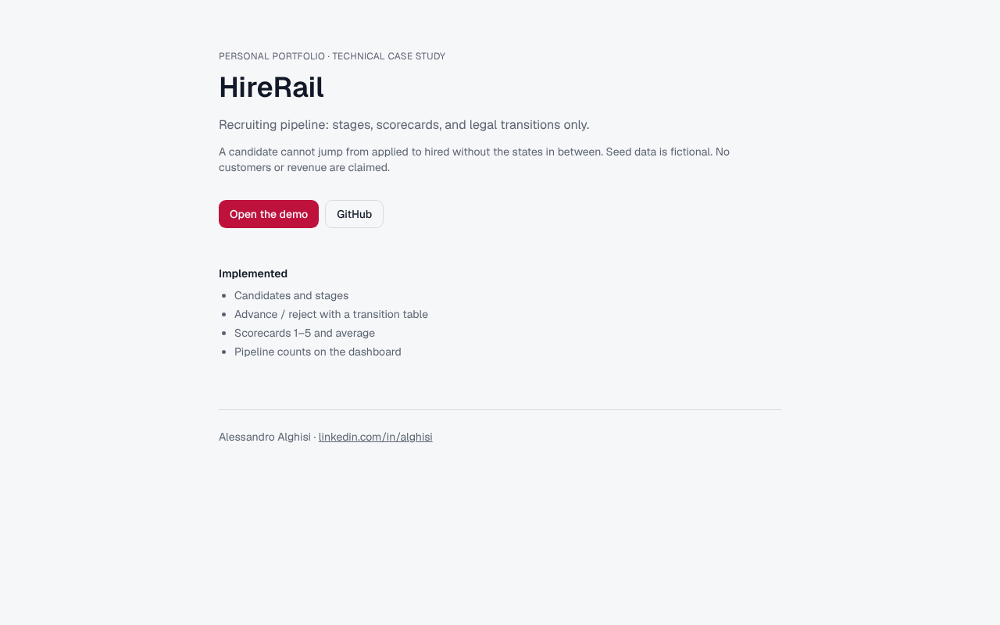

# HireRail

Personal portfolio project / technical case study.

**Download:** [latest release](https://github.com/alexalghisi/hirerail/releases/latest)



Recruiting pipeline: stages, scorecards, and legal transitions only.

It is **not** a hosted commercial product. Seed data is fictional. This repository
does not claim customers, revenue, or production traffic.

**Next.js 16 · React 19 · TypeScript · Tailwind CSS 4 · PGlite (embedded Postgres) · Zod · Vitest**

---

## Author

### Alessandro Alghisi

Senior Software Engineer · Cluj-Napoca, Romania

**Twice a Google Software Engineering Intern** — Chrome (Kitchener / Waterloo)
and Logs (Mountain View).

|          |                                                                    |
| -------- | ------------------------------------------------------------------ |
| GitHub   | [github.com/alexalghisi](https://github.com/alexalghisi)       |
| LinkedIn | [linkedin.com/in/alghisi](https://www.linkedin.com/in/alghisi)                      |
| Email    | [alexalghisi@gmail.com](mailto:alexalghisi@gmail.com)                          |
| Location | Cluj-Napoca, Romania · open to remote / EU / US-friendly timezones |

**Hiring?** Open an issue, message me on LinkedIn, or email
[alexalghisi@gmail.com](mailto:alexalghisi@gmail.com).

---

## Why this exists

A candidate cannot jump from applied to hired without the states in between.

---

## Implemented

- Candidates and stages
- Advance / reject with a transition table
- Scorecards 1–5 and average
- Pipeline counts on the dashboard

## Planned (not built)

- Self-schedule links
- Offer PDF

## Out of scope

- Scraping applicants
- Real employee records

---

## Architecture

One Next.js process: App Router pages, server actions, and (where needed) route
handlers. The database is **PGlite** in `.data/pglite` — real PostgreSQL SQL
without Docker. Set `DATABASE_URL` only if you point this schema at a hosted
Postgres yourself; this MVP does not ship a Compose file because this machine
cannot verify Docker.

`organization_id` always comes from the session (or the ingest key on
SentinelHub). The client never chooses the tenant.

```
Browser  →  Next.js (server actions)
                ↓
         PGlite  (.data/pglite)
```

---

## Local map

Dev server: [http://localhost:3005](http://localhost:3005)

| Surface | Path | What you should see |
| ------- | ---- | ------------------- |
| Landing | `/` | Hiring desk case study |
| Log in | `/login` | Demo recruiter |
| Pipeline | `/app` | Columns by stage, scores, advance / reject |

Buttons use the same rounded `Button` (`rounded-md`) as the rest of the
portfolio. Failed login uses `text-sm text-destructive`.

---

## Setup

Requires Node 22+.

```bash
git clone https://github.com/alexalghisi/hirerail.git
cd hirerail
cp .env.example .env.local
npm install
npm run seed
npm run dev
```

### Demo account (fictional)

|          |                 |
| -------- | --------------- |
| Email    | `demo@hirerail.dev`  |
| Password | `DemoPass123!` |
| Org      | Quay Street Platform        |

Reseed by deleting `.data/pglite` and running `npm run seed` again.

---

## Scripts

```bash
npm run dev          # http://localhost:3005
npm run test         # domain rules (Vitest)
npm run typecheck
npm run lint
npm run build
npm run seed
```

CI runs typecheck, unit tests, lint, and production build on Node 22.

---

## Security notes

- Passwords are bcrypt (12 rounds).
- Session tokens are stored hashed; the cookie is HttpOnly / SameSite=lax.
- Mutating actions re-check the membership role on the server.
- `.env*` and `.data/` are gitignored.

---

## License

MIT · © Alessandro Alghisi
